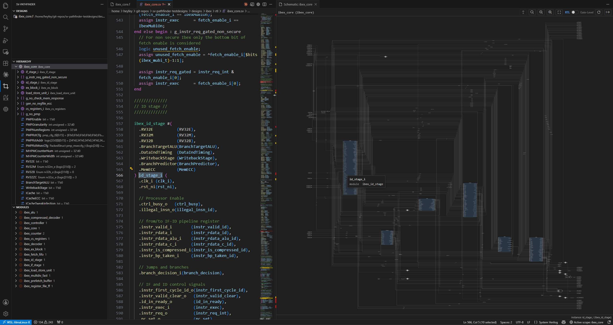

# Schematic Viewer

The schematic renders the RTL (or gate-level) structure of any scope — ports, sub-instances, logic, and wires — elaborated with Yosys



## Setup

Nothing to install. The schematic uses a small Yosys-based toolchain that sv-pathfinder downloads
for you:

1. Right-click a scope in the Hierarchy view → **Show Schematic**.
2. The first time, sv-pathfinder asks to download the schematic runtime (about 20 MB, from this
   project's [GitHub releases](https://github.com/heyfey/sv-pathfinder/releases)). Click **Install**.
3. That is it. Later schematics reuse the installed runtime.

Supported platform: **Linux x64** (any distribution from RHEL/AlmaLinux 8 onwards). macOS and
Windows support is planned.

To download it again, or to repair a broken install, run the command
**sv-pathfinder: Install Schematic Runtime**.

### No internet access on the machine?

Download `sv-pathfinder-schematic-runtime-linux-x64-<version>.tar.gz` from the releases page on
another machine, extract it anywhere on the target machine, and point this setting at the extracted
folder (the one that contains `bin/yosys`):

```jsonc
// settings.json
"sv-pathfinder.schematicRuntimePath": "/path/to/sv-pathfinder-schematic-runtime-linux-x64-<version>"
```

The environment variable `SV_PATHFINDER_SCHEMATIC_RUNTIME` does the same when the setting is empty.

> **macOS note:** if you use a hand-installed runtime on macOS, Gatekeeper may block it on first run.
> Clear the quarantine flag on the runtime folder once, then reload the window:
> ```bash
> xattr -dr com.apple.quarantine "/path/to/runtime"
> ```

## Which designs can be drawn

- **`.f` filelist designs** — always. The schematic re-reads the sources listed in the `.f`.
- **`.uhdm` database designs** — on Linux x64. The schematic reads the database directly, so the
  design appears exactly as Surelog elaborated it, with no defines or include paths to re-enter.
  This reader is new and does not handle every design yet. When it cannot read a database,
  sv-pathfinder tells you once and falls back to re-reading the design's source files instead; if
  the design depends on `+define+` options, that fallback cannot know them, so open the design from
  its `.f` filelist for the schematic. The setting `sv-pathfinder.schematicUhdmFrontend` lets you
  force one of the two behaviors.

## Elaboration modes (`schematicElaborationMode`)

- **`shallow`** *(default)* — elaborates only the selected scope + one level (children as boxes) and
  re-elaborates the next level on demand as you step in or expand. Cheapest to start on large designs.
- **`full`** — the scope you open is elaborated **once**; rendering it, plus step-into, expand, and
  stepping back up, all come from that single elaboration with no re-elaboration. Only navigating
  *above* what you've opened elaborates again. (Rooting at the opened scope, not the design's absolute
  top, avoids elaborating a non-synthesizable testbench above the DUT.) Best for small/medium designs.

## Curated / partial filelists

Unlike the language server, Yosys needs a **self-contained** filelist. The filelist's own directory
and each source file's directory are searched automatically, so a `.f` that omits sibling modules
(like [ibex](https://github.com/lowrisc/ibex)'s `ibex_core.f`) still resolves them.

- If `` `include`` headers live **outside** the source tree (e.g. ibex's vendored `prim_assert.sv` /
  `dv_fcov_macros.svh`), add their directories to **`sv-pathfinder.schematicIncludeDirs`**. A
  schematic error naming a missing file or unknown module points here.
- **Flip side:** Yosys searches those directories, but the navigation backend sees only the files the
  `.f` lists — so the schematic can show a sub-instance the hierarchy tree doesn't have (e.g. ibex's
  `wb_stage_i`, whose `ibex_wb_stage.sv` is omitted from `ibex_core.f`). **Step into** on such an
  instance can't open its scope; it explains why and offers **Go to source** instead. Add the missing
  source to the `.f` to navigate it fully.

## Schematic settings

| Setting | Description |
|---|---|
| `sv-pathfinder.schematicRuntimePath` | Folder of a hand-installed schematic runtime (the one containing `bin/yosys`). Leave empty to use the automatically downloaded one. |
| `sv-pathfinder.schematicElaborationMode` | `shallow` (default) or `full` — see above. |
| `sv-pathfinder.schematicUhdmFrontend` | How `.uhdm` designs are drawn: `auto` (default: read the database, fall back to the source files), `read_uhdm` (database only), or `read_slang` (source files only). |
| `sv-pathfinder.schematicIncludeDirs` | Extra `` `include`` search dirs for Yosys elaboration. |
| `sv-pathfinder.schematicAccentColor` | Accent color for child-instance fills / hover highlights. Any CSS color; empty = theme-aware default. |
| `sv-pathfinder.schematicShowDanglingNets` | Surface declared-but-unconnected nets. Default off. |
| `sv-pathfinder.schematicSpacing` | Layout density: `compact` / `comfortable` (default) / `spacious`. |
